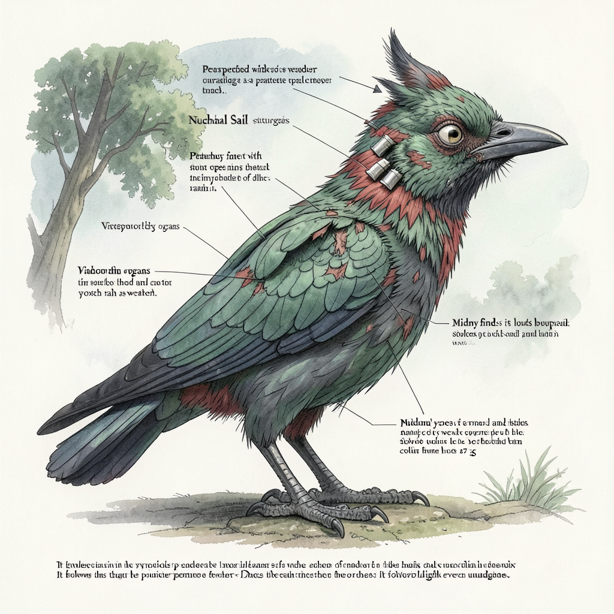

# gguf-zoo

`gguf-zoo` reads the **metadata header** of a `.gguf` model file (weights are
only touched with the opt-in `--in-depth` flag) and procedurally generates a
deterministic fictional **creature field guide**: body size from the parameter
estimate, physical condition from the quantization, senses from the declared
input modalities (via a small trained classifier), and a New-Latin binomial
from the model name and traits.

## Features

- GGUF v2/v3 parser with no third-party GGUF lib; header-only by default,
  `--in-depth` additionally samples tensors.
- Unknown metadata fields become deterministic "cryptid anomaly" organs.
- Parameter-count size ladder (Submicroscopic → Beyond Kaiju) and quant →
  health ladder with additional condition descriptions.
- A small **trained** input-type → sense classifier (GPU when available) with a
  three-run consensus; only externally visible senses are rendered, the rest
  become anomalies (with a focus on fictional senses).
- A second **trained** classifier attributes every unmapped metadata field to a
  best-match physical attribute (real or fictional), so no field is left
  unmapped and no raw key, value, quant name, or input name ever leaks into
  the guide body — only the header block quotes the file.
- Balanced terrestrial / aerial / aquatic habitats with matching locomotion
  features (feathers, wings, fins, gas bladders, …) and plant-like variants.
- Fully deterministic: same input ⇒ byte-identical output.

## Requirements

- Python ≥ 3.11
- [`uv`](https://docs.astral.sh/uv/)
- `numpy`, `torch` (installed by `uv sync`). A CUDA/MPS GPU is used for training
  and inference when present; otherwise CPU.

## Setup

```bash
uv sync
```

## Quickstart

```bash
uv run gguf-zoo infer --demo
```

## Usage

| Command | Description |
|---|---|
| `uv run gguf-zoo infer <file.gguf>` | generate a field guide from a GGUF file |
| `uv run gguf-zoo infer <file.gguf> --in-depth` | sample real weights for the in-depth biology sections (not available with `--meta`) |
| `uv run gguf-zoo infer <file.gguf> --image-url URL --image-model M [--image-key KEY] [--image-size WxH] [--save-image PATH] [--save-description PATH]` | send the IMAGE PROMPT to an OpenAI-compatible image API and save the image + description |
| `uv run gguf-zoo infer --meta metadata.json` | generate from a flat JSON of `key -> value` |
| `uv run gguf-zoo infer --demo [NAME] [--save out.gguf]` | built-in demo model: `qwen2` (default) or `mixtral` |
| `uv run gguf-zoo infer --demo --demo-name NAME --demo-params 7b --demo-quant q8_0` | override the demo's name / parameter count / quant (all optional, case-insensitive) |
| `uv run gguf-zoo infer <file.gguf> --params N` | override the parameter estimate |
| `uv run gguf-zoo train-senses [--seed N] [--device D]` | (re)train the sense classifier |
| `uv run gguf-zoo eval-senses` | report alias-grouped accuracy + confusion matrix |
| `uv run gguf-zoo train-attributes [--seed N] [--device D]` | (re)train the field→attribute classifier |
| `uv run gguf-zoo eval-attributes` | attribute-model accuracy + confusion matrix |
| `uv run gguf-zoo senses --name "mel spectrogram"` | classify one input-type name |
| `uv run gguf-zoo detect-senses <file.gguf>` | classify a file's declared inputs |

Flags: `--device auto|cuda|mps|cpu` (default `auto`) on every subcommand;
`--seed` on the train/senses commands; `--draws` sets the sense classifier's
consensus run count (default 3).

With `--in-depth`, gguf-zoo also reads the file's tensor section: it samples up
to 64 evenly spaced weight blocks per tensor and derives quant-robust statistics
(weight spread, heterogeneity, outlier kurtosis, sparsity, layer trend) that
drive separate biology-manual sections — **APPEARANCE VARIATION**,
**TEMPERAMENT**, **SPECIES BEHAVIOR** (migration, courtship, calls, sociality),
**NATURAL HABITAT**, and **ORGAN VARIATION** (how the species' fictional organs
vary between individuals and shape roles, e.g. larger telepathy organs serving
as the group's scouts). Each line is drawn from a pool of 21 quant-robust
phrasings (7 per statistical bucket); the picks are seeded on the model's name
and architecture only, so different quant levels of the same model yield the
same lines, and the output is fully deterministic (no RNG).

With `--image-url` + `--image-model` (optionally `--image-key`, defaulting to
`$OPENAI_API_KEY`, and `--image-size`), the entry's IMAGE PROMPT is sent to an
OpenAI-compatible `images/generations` endpoint and the returned image is
saved to disk together with the full description. Default file names are
`<model_name>_species_image.<ext>` and `<model_name>_species_description.md`
(model name sanitized); `--save-image` and `--save-description` override them.
This is the only case where gguf-zoo touches the network, and only when you
ask for it. Example (the command that produced the image shown under
"Example input → output", against your own endpoint):

```bash
uv run gguf-zoo infer --demo --demo-name "Grottokeeper Demo" --demo-params 30b --demo-quant q6_k --in-depth --image-url <your-endpoint>/v1 --image-model flux2-klein-4b --image-key no-ai-key --save-image docs/grottokeeper_species_image.png --save-description docs/grottokeeper_species_description.md
```

## Training the classifiers

```bash
uv run gguf-zoo train-senses --device auto
uv run gguf-zoo eval-senses
uv run gguf-zoo train-attributes --device auto
uv run gguf-zoo eval-attributes
```

The sense checkpoint is written to `gguf_zoo/artifacts/sense_clf.pt` (override
with the `GGUF_ZOO_ARTIFACT` env var); the attribute checkpoint to
`gguf_zoo/artifacts/field_attr_clf.pt` (override with `GGUF_ZOO_ATTR_ARTIFACT`).
Both are trained on built-in synthetic datasets labeled by a deterministic
teacher. The attribute classifier maps unmapped metadata field keys to
best-match physical attributes — the real trait families plus eight
fictional attributes (Spiracle Array, Fermentation Crop, …) that absorb unknown
fields as invented anatomy instead of colliding with real traits.

## Example input → output

Input (built-in qwen2-like demo metadata with the `--demo-*` overrides applied):

```json
{"general.architecture": "qwen2", "general.name": "Grottokeeper Demo",
 "general.file_type": 18, "general.size_label": "30B",
 "tokenizer.ggml.pre": "qwen2-vision"}
```

Output of `uv run gguf-zoo infer --demo --demo-name "Grottokeeper Demo" --demo-params 30b --demo-quant q6_k`:

```
---
source_model: "Grottokeeper Demo (qwen2)"
parameters: "~30.0B  ->  size class: Medium (rat to hawk)"
quantization: "Q6_K (Q6_K K-quant)  ->  condition: good"
---

# FIELD GUIDE ENTRY — Grottokiola pilosa viridis Zookeeperia (the Sound)

A half-grown crow — a hairy, green small creature of the cloud forest ceiling. It measures about 25.2 cm from beak to tail and weighs about 179 g. It wears a pelt of interlocking feathers, colored celadon and cinnabar under a monsoon grey-green; colors that read as grey by moonlight, tipped darker at every limb, an asymmetrical splash of colour. On the head: a forward-curving hook with feathered ear-tufts; a single lidless staring eye. Short and thickset, round and barrel-girthed, it carries a short swift digestion tract and forages as a parasite of larger beasts. It is aerial, bearing a launch from the highest perch, feathers layered for lift.

## SENSES

- **Sight** — velvet a halo of lenslets that weep a faint light
- **Touch** — molten a lattice of pressure pits that ring in the rain
- **Vibration** — pulsing a knee that hears the herd that drain colour from their holder

## CONDITION — GOOD

The specimen is no-waste of wing and pinion.
- patchily mangled in blocky clumps, whole swaths of tissue replaced by coarse scar

## UNIQUE TRAITS

- Nuchal Sail (structure) — in the throat, a row of shutters that click open in sequence.

It follows the polarized light even underground.

## IMAGE PROMPT

Wildlife field-guide illustration of a half-grown crow, a hairy, green small creature of the cloud forest ceiling, measuring about 25.2 cm from beak to tail and weighing about 179 g, wearing a pelt of interlocking feathers, colored celadon and cinnabar under a monsoon grey-green, colors that read as grey by moonlight, tipped darker at every limb, an asymmetrical splash of colour, on the head: a forward-curving hook with feathered ear-tufts; a single lidless staring eye, short and thickset, round and barrel-girthed, carrying a short swift digestion tract, foraging as a parasite of larger beasts, aerial animal with a launch from the highest perch, feathers layered for lift, condition: good, the specimen is no-waste of wing and pinion; patchily mangled in blocky clumps, whole swaths of tissue replaced by coarse scar, senses shown by sight organs — velvet a halo of lenslets that weep a faint light; touch organs — molten a lattice of pressure pits that ring in the rain; vibration organs — pulsing a knee that hears the herd that drain colour from their holder, unexplained anatomy: Nuchal Sail (structure) — in the throat, a row of shutters that click open in sequence, behaving thus: It follows the polarized light even underground., natural history field-guide plate, detailed wildlife illustration, watercolor and ink, soft diffused daylight, plain off-white background, full body in profile, scientifically meticulous
```


Output of `uv run gguf-zoo infer --demo --demo-name "Grottokeeper Demo" --demo-params 30b --demo-quant q6_k --in-depth`:

```
---
source_model: "Grottokeeper Demo (qwen2)"
parameters: "~30.0B  ->  size class: Medium (rat to hawk)"
quantization: "Q6_K (Q6_K K-quant)  ->  condition: good"
---

# FIELD GUIDE ENTRY — Grottokiola pilosa viridis Zookeeperia (the Sound)

A half-grown crow — a hairy, green small creature of the cloud forest ceiling. It measures about 25.2 cm from beak to tail and weighs about 179 g. It wears a pelt of interlocking feathers, colored celadon and cinnabar under a monsoon grey-green; colors that read as grey by moonlight, tipped darker at every limb, an asymmetrical splash of colour. On the head: a forward-curving hook with feathered ear-tufts; a single lidless staring eye. Short and thickset, round and barrel-girthed, it carries a short swift digestion tract and forages as a parasite of larger beasts. It is aerial, bearing a launch from the highest perch, feathers layered for lift.

## SENSES

- **Sight** — velvet a halo of lenslets that weep a faint light
- **Touch** — molten a lattice of pressure pits that ring in the rain
- **Vibration** — pulsing a knee that hears the herd that drain colour from their holder

## CONDITION — GOOD

The specimen is no-waste of wing and pinion.
- patchily mangled in blocky clumps, whole swaths of tissue replaced by coarse scar

## UNIQUE TRAITS

- Nuchal Sail (structure) — in the throat, a row of shutters that click open in sequence.

## APPEARANCE VARIATION

- The range of colors within the species is moderate — a family look with individual tweaks.
- One template, faithfully copied, is the species' entire design.
- Colors darken year by year until they turn nearly black.

## TEMPERAMENT

- Predators are met with the same calm as weather.
- Midday finds it at its loudest and busiest.
- Temperament is fixed, shared, and unremarkable.

## SPECIES BEHAVIOR

- Movement is slow, generational, and downhill.
- The dance has three parts and every suitor performs them in order.
- One note, endlessly, is the species' whole vocabulary.
- It gathers in tight, uniform flocks that move as one.

## NATURAL HABITAT

- Territory size tracks food, expanding in lean years.
- It beds down on bare ground in full view.

## ORGAN VARIATION

- The Nuchal Sail does the same small job in every member.
- Nothing turns the Nuchal Sail up or down.

It follows the polarized light even underground.

## IMAGE PROMPT

Wildlife field-guide illustration of a half-grown crow, a hairy, green small creature of the cloud forest ceiling, measuring about 25.2 cm from beak to tail and weighing about 179 g, wearing a pelt of interlocking feathers, colored celadon and cinnabar under a monsoon grey-green, colors that read as grey by moonlight, tipped darker at every limb, an asymmetrical splash of colour, on the head: a forward-curving hook with feathered ear-tufts; a single lidless staring eye, short and thickset, round and barrel-girthed, carrying a short swift digestion tract, foraging as a parasite of larger beasts, aerial animal with a launch from the highest perch, feathers layered for lift, condition: good, the specimen is no-waste of wing and pinion; patchily mangled in blocky clumps, whole swaths of tissue replaced by coarse scar, senses shown by sight organs — velvet a halo of lenslets that weep a faint light; touch organs — molten a lattice of pressure pits that ring in the rain; vibration organs — pulsing a knee that hears the herd that drain colour from their holder, unexplained anatomy: Nuchal Sail (structure) — in the throat, a row of shutters that click open in sequence, in-depth: the range of colors within the species is moderate — a family look with individual tweaks; one template, faithfully copied, is the species' entire design; predators are met with the same calm as weather; midday finds it at its loudest and busiest; colors darken year by year until they turn nearly black; it gathers in tight, uniform flocks that move as one; the dance has three parts and every suitor performs them in order, behaving thus: It follows the polarized light even underground., natural history field-guide plate, detailed wildlife illustration, watercolor and ink, soft diffused daylight, plain off-white background, full body in profile, scientifically meticulous
```


The IMAGE PROMPT above, rendered by model `flux2-klein-4b`:



## How it works

Metadata is mapped to traits (size ladder, quant health, gut/build/eyes/etc.),
the trained sense classifier assigns visible senses to declared inputs, the
trained attribute classifier gives every unmapped field a best-match
attribute, and a seeded `Die` selects prose from fixed pools. Only the header
block quotes the file; the body is pure fiction. With `--in-depth` the tensor
section is additionally sampled for quant-robust weight statistics.
See `.agents/SPEC.md` for the full specification.

## Testing

```bash
uv run pytest -q
```

Every functional requirement in `.agents/SPEC.md` is covered by a test (see
`tests/TRACEABILITY.md`).

## Project layout

```
gguf_zoo/            parser, rules, pools, senses, classifier, attributes,
                     taxonomy, anomalies, weights, demo, render, imagegen,
                     cli, artifacts/
tests/               pytest suite + TRACEABILITY.md
docs/                example species image + description from the README demo
gguf_zoo.py          thin entry shim (prefer the console script)
pyproject.toml       uv project (deps + console script gguf-zoo)
.agents/SPEC.md      full specification
```

## Determinism & license

Same input always yields byte-identical output (no wall-clock, no salted
`hash()`). MIT licensed.
